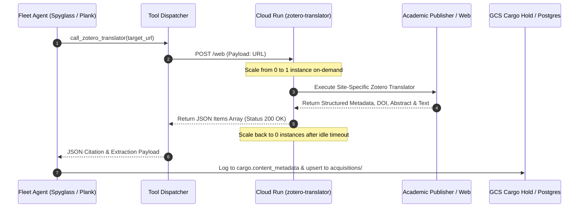

## NPT Fleet: Architecture Decision Records (Master Ledger)

**ADR-001: Atomic Tooling over Monolithic "God Tools"**

* **Context:** The legacy ingestion system relied on a monolithic script handling downloading, cloud uploading, and database logging in a single opaque function.
* **Decision:** Splintered capabilities into atomic, independently callable primitives (`check_cargo_manifest`, `download_url`, `upsert_knowledge_artifact`).
* **Consequences:** Agents possess a granular "Chain of Thought" and can identify exact failure points, though this requires stricter XML prompt governance to prevent deviation.

**ADR-002: Pure PostgreSQL Semantic Memory (Rejection of Vector Abstractions)**

* **Context:** The fleet requires persistent semantic memory across sessions to maintain behavioral rules. Industry patterns heavily favor automated vector-based memory wrappers (e.g., Mem0).
* **Decision:** While LangGraph is retained strictly for short-term turn execution state (`agent_state.checkpoints`), we rejected vector memory abstractions for long-term semantic persistence in favor of pure PostgreSQL (`agent_state.ontology_rules`).
* **Consequences:** Absolute deterministic control. Semantic memory is fully observable and manually editable via standard SQL, eliminating vector-drift hallucinations.

**ADR-003: Strict Database Segregation (Cargo vs. State)**

* **Context:** Mixing content payloads with cognitive state data creates bloated backups, risks cross-contamination, and complicates index optimization.
* **Decision:** The database layer is physically partitioned into two distinct URL connection strings and logical schemas: `CONTENT_DATABASE_URL` maps to the `cargo` schema; `DATABASE_URL` maps to the `agent_state` schema.
* **Consequences:** Tools must explicitly declare which connection they require, establishing a hard firewall between what the agents *think* and what the agents *read*.

**ADR-004: Continuous File Telemetry over Cloud Logging**

* **Context:** Forcing standard output streams into GCP Cloud Logging during local development creates high latency and requires heavy IAM permission management.
* **Decision:** The `AgentEngine` is hardcoded to dump the fully assembled XML + DB system prompt to `logs/<agent_name>_system_prompt.txt` on initialization, and append every interaction to `logs/<agent_name>_interactions.log`.
* **Consequences:** Absolute offline observability for the human architect, requiring strict `.gitignore` enforcement.

**ADR-005: Dual-Mode Entrypoints (Headless vs. Interactive)**

* **Context:** Agents need to be orchestrated by automated batch-runners (Pegleg) but also require direct human coaching via the terminal.
* **Decision:** Entrypoint runners implement a dual-mode `if/else` logic gate: Mode A (Headless) triggers via specific command-line flags for sequential execution; Mode B (Interactive) drops the human into a `while True:` loop for real-time coaching.

**ADR-006: Deterministic Artifact Storage & Ingestion Upserts**

* **Context:** Using timestamp-based filenames during an upsert creates orphaned "ghost" files in Google Cloud Storage, quietly driving up storage costs.
* **Decision:** We mandate Pure Determinism in cloud storage. All acquired knowledge artifacts use a deterministic file slug derived directly from the canonical URL. Timestamp-based file names for content artifacts are explicitly banned.
* **Consequences:** The GCP bucket functions as a self-cleaning key-value store. Reprocessing a URL automatically overwrites the old blob, eliminating storage bloat.

**ADR-007: Receipt-Based Token Economics & Deterministic Ingestion Fallbacks**

* **Context:** Passing 50,000+ character HTML payloads back into the LLM’s chat history just to trigger an upload tool was bankrupting the token economy.
* **Decision:** Text manipulation is shifted out of the LLM context. The `download_url` tool saves the raw text to a local cache and returns a lightweight JSON "receipt" to the agent. Furthermore, live self-learning for ingestion was rejected in favor of a deterministic Tier 1 (`requests`) to Tier 2 (`Botasaurus`) fallback.
* **Consequences:** Token consumption per ingested article drops by roughly 99%. Spyglass is structurally barred from performing qualitative analysis during the ingestion phase.

**ADR-008: The JSONB Silver Ledger (Rejection of Markdown Dumps)**

* **Context:** Downstream synthesis agents (Scallywag) cannot reliably parse or query unstructured text files dumped by mid-tier analytical agents (Cutlass).
* **Decision:** We mandate that all Silver-tier epistemic triage and enrichments must be formatted as strictly typed JSON objects and inserted into a PostgreSQL ledger (`cargo.fleet_enrichments`) via the `log_fleet_enrichment` tool.
* **Consequences:** The system gains a highly structured, mathematically queryable database of epistemic failures, drastically improving the reliability of the Gold-tier synthesis phase.
**ADR-009: Standardizing Agent XML Schema and Rules Ingestion Engine**

* **Context:** Legacy agent profiles used non-standard `<heuristics>` tags which were silently ignored by `AgentEngine`, truncating rules into single-line summaries and leaving orchestrators like Pegleg without full rule visibility. Furthermore, multi-step workflows were mislabeled as passive `<core_mandate>` text rather than executable `<skills>`.
* **Decision:** 
  1. Deprecate legacy `<heuristics>` XML tags across all agent definitions in favor of standard `<rules>` (operational boundaries) and `<guardrails>` (anti-hallucination/sycophancy controls).
  2. Refactor `AgentEngine._build_dynamic_system_prompt()` to load and format the full rule directive, rationale, and context without character truncation.
  3. Reclassify multi-stage workflows as executable `<skills>` with explicit protocols.
  4. Ensure orchestrators run true `AgentEngine` ReAct sessions rather than hardcoded Python prompt strings.
* **Consequences:** Agents operate with 100% prompt visibility into their full rule directives and guardrails. System instructions become completely observable, consistent across agents, and aligned with modern AI agent engineering standards.

**ADR-010: Dual Progenitor Convergence (Hook-Antigravity Cognitive Parity & Human Backlog Governance)**

* **Context:** The system maintained two separate meta-architectural execution environments: Antigravity (the IDE pair-programmer governed by `GEMINI.md`) and Hook (the autonomous CLI progenitor governed by `Hook_constitutiuon.md` and `hook.xml`). Over time, this caused Split-Brain Drift: Hook operated on stale, hardcoded agent rosters and legacy tool paths, while Antigravity operated on live project reality. Furthermore, GitHub Issues was being misused as an automated error dump by content scrapers (e.g. Spyglass opening issues for 403 HTTP paywalls), drowning human architectural ideas in backlog noise.
* **Decision:**
  1. *Dual-Harness Coexistence:* Both Hook (terminal/CLI runner) and Antigravity (IDE pair-programmer) remain fully active and supported.
  2. *Cognitive & Mandate Parity:* Hook and Antigravity share an identical engineering personality and operational mandate. `GEMINI.md` absorbs Hook's core engineering virtues: Structural Finality (complete implementations; zero conversational fluff), Strict Spatial Verification & PIP Compliance (mandatory physical tool calls to read disk before asserting facts), and Leading with Decisions before rationale.
  3. *Single Source of Truth Bootstrapping:* `hook_runner.py` and `hook.xml` dynamically ingest `GEMINI.md` and `fleet_roster.json` on startup via `AgentEngine`. Hook will no longer maintain a divergent, hardcoded roster.
  4. *GitHub Issues Namespace Boundary:* GitHub Issues is designated exclusively as the Human Architect & Meta-Architect Backlog (Timothy, Hook, and Antigravity). Domain content agents (Spyglass, Cutlass, Grog, Plank, Bilgeladle, Scallywag) are strictly stripped of GitHub issue-creation tools. Content acquisition failures must be logged exclusively to `cargo.failed_metadata` (per ADR-003), preventing scraper noise from polluting the backlog.
* **Consequences:** Perfect alignment between IDE and terminal sessions. Zero drift between Antigravity and Hook. Clean, high-signal GitHub backlog dedicated entirely to deliberate human feature requests and architectural changes.

**ADR-011: Unified Developer Action Logging & Interaction Provenance**

* **Context:** To maintain system integrity and auditability across rapid multi-agent evolution, the human architect requires an unbroken, offline forensic log of all user requests, agent decisions, tool invocations, and parameter mutations executed by both Hook (in terminal) and Antigravity (in IDE).
* **Decision:**
  1. *Antigravity Native Telemetry Integration:* Formally leverage Antigravity's built-in session transcript engine located at `<appDataDir>/brain/<conversation_id>/.system_generated/logs/transcript.jsonl` (and `transcript_full.jsonl`). These append-only JSONL ledgers record every user prompt, model reasoning step, tool call, and stdout response with microsecond timestamps.
  2. *Standardized Hook Turn Logging:* Standardize Hook's local file logging to mirror this depth: Every user request and turn prompt is committed to `logs/hook_requests.log`; every tool call, raw stdout response, and error payload is streamed to `logs/hook_interactions.log`; system prompt compilation states are dumped to `logs/hook_system_prompt.txt` upon engine boot (per ADR-004).
  3. *Log Directory Governance:* All local log dumps remain strictly localized in `logs/` and permanently excluded from version control via `.gitignore`.
* **Consequences:** 100% forensic replayability of all architectural modifications regardless of whether they were performed via Antigravity in the IDE or Hook in the terminal.

**ADR-012: Cross-Harness Bi-Directional Learning (Shared Rule Vaults)**

* **Context:** When a developer corrects a behavior or discovers a new heuristic in Antigravity (e.g. using `/learn` or refining an architectural pattern), that learning historically remained trapped in IDE memory or `GEMINI.md`. Conversely, rules recorded by Hook via `record_learned_rule` went into local agent JSON files that Antigravity might not immediately index.
* **Decision:**
  1. *Shared Knowledge Vaults as Single Source of Truth:* All operational heuristics, behavioral corrections, and architectural rules are standardized into two shared, version-controlled JSON vaults: `src/react_agent/core_knowledge_vault/shared_fleet_rules.json` (Fleet-universal rules) and `src/react_agent/agents/{agent_name}/learned_rules.json` (Agent-specific local rules).
  2. *Bi-Directional Learning Protocol:*
     - *Antigravity -> Hook:* When Antigravity learns or refines an engineering directive during pair programming, the rule is committed directly to `shared_fleet_rules.json` (or `GEMINI.md`). On the next terminal invocation of `hook_runner.py`, Hook immediately boots with that new learned rule in her system prompt.
     - *Hook -> Antigravity:* When Hook generates a rule during terminal execution via `record_learned_rule`, it is written to the shared JSON vaults and referenced in `GEMINI.md`, instantly making it visible to Antigravity.
  3. *Deprecation of Isolated Learning Sinks:* Deprecate separate, one-off XML rule staging directories (`src/react_agent/agents/hook/rules/*.xml`) and legacy ledgers (`learning_ledger.json`) in favor of direct commits to the shared JSON vaults.
* **Consequences:** Continuous, cross-pollinating intelligence. A lesson taught once to Antigravity in the IDE is permanently learned by Hook in the terminal, and vice-versa. Strict JSON schema adherence required for rule formatting.

**ADR-013: Hybrid Memory & Pointer Architecture (Full Manuscript System Prompt Injection with On-Demand Section Expansions and Receipt-Based Cargo Handoffs)**

* **Context:** Large language models historically suffered from small context windows, prompting Map-Reduce section slicing. However, modern models (Gemini 3.7 Flash) offer 1M+ token context with high recall at $0.07/1M input tokens. Loading the complete 374 KB manuscript into Bilgeladle's system prompt costs ~$0.007 per turn while providing complete, un-fragmented thesis memory. Meanwhile, multi-agent cargo handoffs (Spyglass -> Cutlass -> Grog -> Bilgeladle -> Scallywag) exploded in cost when raw article texts and full section expansions were concatenated directly into prompt strings.
* **Decision:**
  1. *Full Manuscript Corpus Injection for Bilgeladle:* `AgentEngine` will continue injecting `ship/bronze_plus/End-of-Knowing-latest.md` directly into Bilgeladle's system prompt, giving her complete, unbroken thesis vision for <$0.01 per turn.
  2. *Receipt-Based File Pointers for Incoming Cargo (ADR-007 Enforcement):* Inter-agent multi-stage pipelines must pass lightweight file pointers / GCS paths (`acquisitions/[slug].txt`) and database IDs rather than concatenating raw text strings into prompts. Downstream agents stream or inspect files on demand via `read_knowledge_artifact` / `read_local_file`.
  3. *On-Demand Section Expansions (`ship/expansions/`):* Deep section expansions (e.g. `ch01_sec1.4_expansion.md`) are preserved as specialized reference deep-dives, loaded on-demand via tool calls (`read_local_file`) when a specific section requires forensic audit.
* **Consequences:** Bilgeladle maintains total, un-fragmented manuscript awareness at negligible cost (~$0.007/turn), while multi-agent chases reduce prompt context payload size by ~99% per turn across the fleet.

**ADR-014: Serverless Zotero Translation Engine on Google Cloud Run**

* **Context:** External academic publishers (Nature, ScienceDirect/Elsevier, IEEE Xplore, JSTOR, Springer, Wiley) enforce severe scraping countermeasures (Cloudflare Turnstile, browser fingerprinting, and paywall authentication gates). Standard HTTP requests return HTTP 403, and headless browsers like Botasaurus frequently hang on heavy CAPTCHA challenges or fail to capture the underlying citation graph. Meanwhile, Zotero's open-source Translation Server maintains thousands of specialized, community-curated web scrapers ("translators") engineered specifically to extract rich bibliographic metadata and article text from scholarly databases. However, running a persistent Kubernetes (GKE) cluster or compute instance for translation services incurs an unacceptable idle overhead ($70+/month for GKE control planes alone).
* **Decision:**
  1. *Serverless Microservice Architecture:* Deploy the Zotero Translation Server to Google Cloud Run as a managed, stateless service (`zotero-translator`) in region `us-central1`.
  2. *Scale-to-Zero Guardrail:* Enforce `--min-instances=0` and `--max-instances=2`. When no ingestion or reference resolution tasks are running, Cloud Run scales to zero instances, ensuring a **$0.00 idle operating cost**. Cold-start latency on Cloud Run is under 2 seconds.
  3. *Cloud Build Recursive Container Assembly:* Package the container using Node 20 LTS via Google Cloud Build, cloning the repository with `--recurse-submodules` to incorporate all required Zotero submodules (`modules/translators`, `modules/utilities`, `modules/zotero-schema`, `modules/translate`). Bind Node natively to `0.0.0.0:8080` to eliminate shell script execution format errors.
  4. *Multi-Agent Fleet Tool Dispatch:* Expose `call_zotero_translator(target_url)` across `acquisition_tools.py` and `tool_dispatcher.py`. Grant access to **Spyglass** (for bypassing academic paywalls during external cargo acquisition) and **Plank** (for expanding and verifying un-truncated vector node citations in manuscript chapters).
* **System Flow & Sequence:**



* **Consequences:** Eliminates scraping barriers on protected scholarly domains. Yields bit-for-bit extraction of complex citation structures (authors, DOIs, volume, issue, publication dates, and abstracts) directly matching Zotero's data contract. Incurs zero compute expense when idle.

**ADR-015: Two-Tier Content Storage Architecture: Permanent Asset Dossiers vs. Chase Synthesis Sinks**

* **Context:** In multi-stage investigative sweeps ("Chases"), early stage deliverables—specifically Cutlass's epistemic and structural logic audit (Stage 2) and Grog's core factual extraction (Stage 3)—were historically written directly into transient chase folders (`writings/chases/{chase_id}/stage2_cutlass_{slug}.md`). However, Round 1 audits are strictly prompt-free, objective deconstructions of what the external content says, what it is, and its evidentiary warrants. Trapping these evaluations in specific chase folders forced the fleet to redundantly re-audit assets when reused across different chases, chapter expansions, or standalone research sprints, wasting substantial LLM tokens and API budget. Furthermore, running multi-turn asset audits in monolithic chase threads caused exponential context token accumulation.
* **Decision:**
  1. *Physical Output Separation:* Establish a strict physical boundary between **Reusable Asset Dossiers** and **Chase Synthesis Deliverables**:
     - **Reusable Asset Dossiers (`writings/cargo/cargo_{metadata_id}/`)**: Indexed permanently by database metadata ID (`cargo_{id}`). Houses objective, prompt-free asset assessments:
       - `cutlass_audit.md`: Epistemic deconstruction (SAYS vs IS), Chain of Ruin evaluation, Causal Warrants & Claims, Epistemic Fallacy Scan, Sail Locker rating (`MAINSAIL`/`BILGE`/`JIB`), and Epistemic Scorecard.
       - `grog_extraction.md`: Dead Reckoning, Fact Plumbing, Strict Summary, and Reference Sightings.
       - `cargo_ontology.json`: Entity-relationship knowledge graph primitives.
     - **Chase Synthesis Sinks (`writings/chases/{chase_id}/`)**: Reserved strictly for deliverables that compare multiple assets or directly answer the Author's thesis prompt:
       - `stage4_bilgeladle_alignment.md`: Thesis mapping of the asset cluster against manuscript chapters.
       - `stage5_scallywag_essay.md`: Satirical synthesis essay answering the Author's inquiry prompt.
       - `stage6_peer_reviews.md`: Bilgeladle and Cutlass peer consensus reviews of Scallywag.
       - `chase_status.md`: Real-time stage gate and telemetry log.
  2. *Pre-Flight Reuse Gate:* Before dispatching Cutlass (Stage 2) or Grog (Stage 3), Pegleg must inspect `writings/cargo/cargo_{metadata_id}/`. If the deliverable exists, Pegleg reuses it immediately with **zero token spend**.
  3. *Deterministic Thread Binding:* Asset-level subagent turns are bound to `cargo_{metadata_id}_{agent_name}` (e.g. `cargo_238_cutlass`), ensuring clean ~25k token context windows and perfect resuscitability for subsequent revisions.
* **Consequences:** Eliminates redundant token expenditure across multi-asset chases. Creates a cumulative, searchable knowledge repository of audited cargo assets. Decouples objective forensic deconstruction from prompt-biased narrative synthesis. Ensures tri-fold alignment across PostgreSQL (`cargo.content_metadata.id`), ReAct cognitive threads (`cargo_{metadata_id}`), and disk storage (`writings/cargo/cargo_{metadata_id}/`).

**ADR-016: Standard Python >=3.12 Runtime and Pure-Python PEP-249 `pg8000.dbapi` Database Driver Mandate**

* **Context:** Inconsistencies emerged across fleet tools, runner entrypoints, and administrative helper scripts regarding Python runtime versions and PostgreSQL client libraries. Specifically:
  1. *PostgreSQL Driver Fragmentation:* Several scripts inadvertently imported `pg8000.native` (which uses a proprietary `.run(":id", ...)` syntax without standard cursors) while core engine tools used `pg8000.dbapi` (PEP-249 standard). LLM subagents frequently hallucinated broken queries when attempting to emulate `native` syntax, mismanaged connection lifecycles, and left database sockets hanging. Furthermore, legacy entries for `psycopg[binary]` and `psycopg-pool` in `pyproject.toml` introduced compilation and platform wheel conflicts on Windows workstations.
  2. *Python Runtime Drift:* Agent code occasionally targeted deprecated Python 3.11 syntax or experimental pre-release features of 3.14+, risking syntax errors in production.
* **Decision:**
  1. *Python Runtime Version:* Mandate `Python >=3.12` (`3.12.x`) managed via `uv`. Subagents, firmwares, and tools must never target Python 3.11 or unverified 3.14+ pre-releases.
  2. *Universal Driver Mandate:* All database interactions across tools, entrypoints, and scripts MUST strictly use `import pg8000.dbapi` adhering to PEP-249 (Python Database API Specification 2.0).
  3. *Query Pattern & Resource Lifecycle:*
     - Queries must use standard DB-API `%s` placeholders with sequence/tuple parameters (`cursor.execute("SELECT ... WHERE id = %s", (asset_id,))`).
     - Connections and cursors must be acquired on-demand and enclosed in strict `try: ... finally: cursor.close(); conn.close()` blocks.
  4. *Explicit Bans:*
     - **Ban `pg8000.native`**: Prevents broken query syntax, non-standard parameterization, and transaction failures.
     - **Ban `psycopg` (v3) & `psycopg2`**: Eliminates external C compiler / compiled binary wheel dependencies, ensuring 100% pure-Python cross-platform execution on Windows developer environments.
* **Consequences:** High LLM code generation reliability (~99% syntax accuracy for PEP-249), zero C-library installation failures across Windows/Linux, consistent transaction and socket cleanup, and unified database connection handling across all tools and scripts.

**ADR-017: Two-Step Manuscript Thesis Navigation: Macro-Structural Triage via Ship Deck Plans and On-Demand Bronze+ Chapter Ingestion**

* **Context:** Historically, Bilgeladle's system prompt was pre-loaded with the complete ~120-page manuscript monolith (`ship/bronze_plus/End-of-Knowing-latest.md`, ~100k tokens). While this preserved global thesis context, it saturated Bilgeladle's context window, degraded reasoning agility during multi-asset chases, and caused cognitive indiscriminate drift where the model anchored to minor anecdotes rather than the core vector of destruction. Conversely, relying strictly on traditional micro-chunk RAG resulted in narrative fragmentation, loss of authorial voice, and amnesia regarding chapter-length argumentative build.
* **Decision:**
  1. *Replace Monolith Prompt Dump with Ship Deck Plans:* In `AgentEngine`, replace the ~100k monolith injection with `ship/SHIP_DECK_PLANS.md` (~18k tokens). Bilgeladle holds the 13 Master Chapter Backbones (5-Part Schema: Title/Sector, Vector of Destruction, Invariant Predicates, Universal Doom Point, and 140 calibrated Section Ribs) as permanent working memory.
  2. *Step 1: Macro-Structural Triage:* Bilgeladle evaluates incoming cargo against the Ship Deck Plans in working memory to triage and lock EXACTLY ONE Primary Chapter Anchor (integer 0–12, Guardrail-006) and candidate Section Ribs without burning token overhead on full prose.
  3. *Step 2: On-Demand Grounded Verification (Dual-Tool Execution):*
     - **Standard Path (`read_manuscript_chapter`):** When the primary chapter anchor is identified with high confidence, Bilgeladle invokes `read_manuscript_chapter(chapter_number)` to stream the complete, un-truncated Bronze+ chapter prose (~2k–12k tokens) to harvest exact opening vignettes, verbatim author quotes, and Toulmin warrants.
     - **Cross-Cutting Fallback (`vector_search_manuscript`):** When cargo touches ambiguous or multi-chapter phenomena, Bilgeladle invokes `vector_search_manuscript(query, chapter_number=None)` across `ship.letters_of_marque` (868 embedded 1536-dim paragraph chunks) to discover specific high-similarity section ribs before locking the primary chapter.
  4. *Deprecation of Monolithic Injection:* Monolithic full-book prompt injection is permanently retired.
* **Consequences:** Reduces Bilgeladle's baseline turn footprint by ~82,000 tokens per turn (~82% reduction), frees massive context space for multi-asset synthesis, prevents chunk fragmentation by loading complete chapters on demand, guarantees grounded author quotes, and equips Bilgeladle with both macro-structural foresight and micro-semantic retrieval.

**ADR-018: Financial Circuit Breakers, Safe Batch Defaults, and Context Cache Lifecycle Management**

* **Context:** In September 2026, an unmonitored batch execution (`batch_reprocess_cargo.py --locker BILGE` and `--locker DOLDRUMS`) iterated through 160 cargo assets in 90 minutes across 760 LLM turns without a `--limit` constraint. Because Bilgeladle's prompt injects 152KB (`SHIP_DECK_PLANS.md`, ~55k tokens) on every call without caching, the run consumed over 22 million input tokens in a single evening. Furthermore, user-specified prompt constraints like `"spending cap of $0.50"` were unparsed text, as `AgentEngine` lacked financial accumulators, dollar rate tables, and hard cost circuit breakers.
* **Decision:**
  1. *Safe Defaults on Batch Entrypoints:* Batch scripts must never default to unbounded database sweeps. `--limit` defaults strictly to 5 assets. Iterating over the full backlog requires `--all` plus an interactive confirmation prompt (`[y/N]`) unless overridden with `--yes`.
  2. *Real-Time Token Telemetry & Financial Governor (`CostTracker`):* Bind a central `CostTracker` into `AgentEngine`. Extract exact `usage_metadata` from every API response, compute running USD spend based on model rate tiers, and print real-time telemetry to the CLI.
  3. *Immutable Spending Cap Circuit Breaker:* Automatically parse spending caps from CLI arguments (`--spending-cap 0.50`) and user prompts (e.g. `spending cap of $X.XX`). When cumulative run spend reaches 100% of the cap, immediately raise `SpendingCapExceededException` and abort execution before launching subsequent turns or tools.
  4. *Gemini Context Cache Lifecycle & Teardown Protocol:* Static prompt payloads exceeding 10k tokens (e.g. Bilgeladle's `SHIP_DECK_PLANS.md`) will leverage Gemini Explicit Context Caching (`client.caches.create`), reducing input token costs by 75-80%. All caches must carry a strict maximum TTL of 1 hour (`ttl="3600s"`). Workflows must register a cleanup handler (`client.caches.delete(cache.name)`) in `finally:` blocks, and `helper_scripts/purge_gemini_caches.py` is established as the manual teardown tool documented in the Fleet Manual.
* **Consequences:** Completely eliminates runaway batch spending. Guarantees that declared spending caps are hard physical boundaries. Cuts repeated Bilgeladle input token billing by 75-80%. Ensures no lingering cache storage costs on Google Cloud after task completion.

**ADR-019: Retirement of External Cargo pgVector Indexing in Favor of Managed Vertex AI Search & Macro Folksonomy**

* **Context:**
  1. *Cargo Vector Overhead & API Costs:* The fleet initially provisioned `cargo.content_vectors` in Cloud SQL to store 1536-dimensional embeddings (`gemini-embedding-001`) of external cargo paragraph chunks. With over 4,000 full-text acquisitions in `gs://npt-fleet-cargo-hold/acquisitions/`, embedding every article paragraph created substantial API token expense, hit provider rate limits and credit quotas, and imposed compute and storage strain on the Cloud SQL PostgreSQL instance (requiring large memory allocations for HNSW/IVFFlat indexes).
  2. *Redundancy with Vertex AI Search:* The fleet deployed a managed GCP Vertex AI Search data store (`npt-cargo-poc`) and search engine (`npt-cargo-search-app`) directly over `gs://npt-fleet-cargo-hold/acquisitions/*.txt`. Vertex AI Search provides native hybrid search (BM25 exact keyword matching + dense semantic vector search) and extractive snippet generation directly from raw files without requiring custom chunking or database embedding pipelines. It operates under Google Cloud's generous free tier (10,000 search queries/month free).
  3. *Macro Navigation Needs:* Browsing and categorical orientation across the cargo hold are best served by relational SQL queries, metadata facets, and the Level 1/Level 2 emergent Folksonomy outlined in GitHub Issue #120, making a secondary vector database in PostgreSQL redundant for external cargo.

* **Decision:**
  1. *Retire Cargo Vector Indexing Pipeline:* Cease all ongoing and automated vector embedding generation and chunk ingestion into `cargo.content_vectors`. Remove vector indexing from ingestion loops and batch worker paths.
  2. *Preserve Existing Cargo Vectors (Frozen State):* Existing rows already computed and loaded into `cargo.content_vectors` (3,711 chunks across 151 assets) are retained in place and will **not** be purged or dropped at this time. They remain accessible for historical queries, but no new embedding spend will be incurred.
  3. *Uncompromised Preservation of Manuscript Vectors (`ship.letters_of_marque`):* The manuscript Vector Database (`ship.letters_of_marque`, containing 868 embedded paragraph chunks of *The End of Knowing*) remains 100% active and supported. It is strictly separate from external cargo and is essential for Bilgeladle's micro-semantic chapter cross-examinations.
  4. *Division of Retrieval Labor:*
     - *Macro Landscape & Thematic Slicing:* Handled via PostgreSQL metadata + Folksonomy (Issue #120 / `cargo.v_cargo_landscape`) at $0.00 cost.
     - *Micro Cargo Full-Text & Semantic Search:* Handled via Vertex AI Search (`npt-cargo-search-app` / `search_cargo_vertex`) directly indexing raw GCS text files.
     - *Manuscript Thesis Anchoring:* Handled via `ship.letters_of_marque` in PostgreSQL.

* **Consequences:** Unifies the entire fleet on Google's current SOTA text embedding model. Halves vector database storage and query FLOPs. Eliminates redundant embedding API calls. Enables direct manuscript-to-cargo mathematical distance comparisons. Guarantees 100% full-text coverage with no truncation blindspots.

**ADR-021: Fleet Maintenance Engine & Thread Immunity Architecture ("Swabbing the Decks")**

* **Status:** Accepted & Operational
* **Date:** 2026-10-19
* **Context:**
  1. *Unbounded Database Checkpoint Accumulation:* ReAct execution turns persist serialized agent session states into PostgreSQL (`agent_state.checkpoints`). Over time, ephemeral CLI test runs and scratch UUID threads accumulate hundreds of stale rows.
  2. *The Context Cost of Premature Deletion:* Completely dropping or truncating all conversational history is dangerous. If a human author identifies weeks later that an agent miscategorized an asset or misassigned a sail locker, re-entering that existing thread allows immediate, low-token corrective steering without paying the full prompt ingestion fee again.
  3. *Filesystem and Log Accumulation:* Scraper temporary buffers (`cargo_cache/temp_acquire_*.txt`), oversized logs (`logs/*.log` > 5MB), and unorganized scratch essays in `writings/` accumulated without an automated hygiene mechanism.
* **Decision:**
  1. *Canonical Maintenance Utility:* Codify `helper_scripts/maintenance/swab_the_decks.py` as the official fleet maintenance routine, executable in dry-run mode (`--dry-run`) or live execution (`--execute`).
  2. *Thread Immunity Protocol:* All threads following the deterministic pattern `thread_cargo_{metadata_id}` (or `thread_cargo_*`) are granted **100% Permanent Thread Immunity**. They are never pruned or deleted by automated routines.
  3. *Ephemeral Pruning Thresholds:* UUID-based scratch threads older than 14 days and completed chase sessions older than 30 days are pruned from `agent_state.checkpoints` and `agent_state.checkpoint_writes`.
  4. *DDL Root Law in Maintenance:* Table drops or alterations (such as dropping legacy public checkpoint tables) must connect as the `postgres` superuser using `DB_ROOT_PASSWORD` per SOP-06.
  5. *Log Rotation & Compression:* Active logs exceeding 5MB are automatically rotated, compressed (`.gz`), and moved to `logs/archive/`.
  6. *Asset Dossier Immunity:* Files residing in `writings/cargo/cargo_{id}/` and `writings/cargo/FLEET_SIGHTINGS_LEDGER.md` are protected with absolute filesystem immunity. Loose essays in the root of `writings/` are safely archived to `writings/archive_essays/`.
* **Consequences:** Automates lifecycle hygiene across database checkpoints and disk storage while guaranteeing that high-value cargo correction threads and permanent research dossiers are never lost.

**ADR-022: Helper Script Lifecycle, Metadata Headers & Self-Updating Run Tracking (`run_tracker`)**

* **Status:** Accepted & Operational
* **Date:** 2026-10-19
* **Context:**
  1. *Helper Script Abandonment & Drift:* Over the lifecycle of the project, 70+ administrative scripts accumulated in `helper_scripts/`. Developers and agents lacked visibility into how to run each tool, what it does, and whether it was active, superseded, or abandoned.
  2. *Scratch Leakage:* One-off exploratory scripts were frequently saved directly to `helper_scripts/` rather than `scratch/`, cluttering the operational tooling inventory.
* **Decision:**
  1. *Mandatory Standard Header:* Every script in `helper_scripts/` must contain an authoritative top-of-file docstring formatted with exactly three fields:
     - `How to run`: Explicit terminal command (e.g. `uv run python helper_scripts/<name>.py`).
     - `What it does`: 1-2 sentence concise summary of operational scope.
     - `Last run`: `Unknown` or an automated ISO/timestamp string (`YYYY-MM-DD HH:MM:SS`).
  2. *Automated Execution Tracking Hook:* Every helper script must embed the lightweight `run_tracker` hook:
     ```python
     try:
         import os, sys
         _tracker_dir = os.path.join(os.path.dirname(__file__), "..") if os.path.basename(os.path.dirname(__file__)) in ("db_provisioning", "maintenance") else os.path.dirname(__file__)
         if _tracker_dir not in sys.path:
             sys.path.insert(0, _tracker_dir)
         import run_tracker
         run_tracker.record_run(__file__)
     except Exception:
         pass
     ```
  3. *Audit & Compliance Verification:* `helper_scripts/run_tracker.py` maintains an audit interface (`uv run python helper_scripts/run_tracker.py --audit`). All helper scripts must maintain 100% compliance.
  4. *Scratch Separation (SOP-10):* One-off investigation scripts must be saved to `scratch/`. They may only be promoted to `helper_scripts/` once they adhere to the standard header and run tracking protocol.
* **Consequences:** Eliminates documentation drift, makes tooling self-documenting, and provides the human architect with instant visibility into which tools are actively exercised versus candidates for archival.


**ADR-020: Unified Fleet Vector Modernization: Standardization on `text-embedding-005` (768-dim) Across Ship and Cargo**

* **Status:** Formally supersedes ADR-019 (unfreezes cargo pgvector indexing under the modern, cost-controlled standard).
* **Date:** 2026-10-15
* **Context:**
  1. *Model Deprecation & Dimensional Fragmentation:* The fleet previously provisioned both `ship.letters_of_marque` and `cargo.content_vectors` with legacy 1536-dimensional vectors (`gemini-embedding-001`). Meanwhile, modern diagnostics invoked `text-embedding-004` (768-dim), resulting in database schema rejection, discarded RAM calculations, and redundant token billing. Furthermore, Google scheduled `text-embedding-004` for discontinuation in favor of `text-embedding-005`.
  2. *Re-evaluation of ADR-019 Cargo Freeze:* ADR-019 froze cargo vector indexing due to perceived API token costs and Cloud SQL memory overhead (partially caused by complex workflows attempting to pre-filter and triage cargo before embedding). With Google's production `text-embedding-005` pricing at $0.15 per 1M tokens, embedding the entire 3,600+ article catalog costs less than $3.00, and cutting dimensionality from 1536 to 768 reduces PostgreSQL index RAM overhead by 50%.
* **Decision:**
  1. *Universal Embedding Model:* All vector embeddings across the fleet (`ship` and `cargo`) must exclusively use `model="text-embedding-005"` with native **768 dimensions** (`output_dimensionality=768`). Legacy `gemini-embedding-001` and deprecated `text-embedding-004` are permanently retired.
  2. *Schema Alteration:* Migrate both `ship.letters_of_marque.vector_embedding` and `cargo.content_vectors.vector_embedding` column types from `vector(1536)` to `vector(768)`.
  3. *Strict Full-Text Zero-Truncation Law (SHARED-HEURISTIC-025 Compliance):* Arbitrary head-truncation (e.g., slicing the first 400 or 500 words of an article) is strictly prohibited. Embeddings must represent 100% of the acquired full text.
  4. *Chunking Granularity & 1,200-Token Ceiling:*
     - Documents are decomposed by natural paragraph boundaries (`\n\n`).
     - **Chunk 000 (Metadata Anchor):** Title, Authors, Published Date, Source URL.
     - **Chunks 001..N (Verbatim Body Paragraphs):** Preserved verbatim. If any individual paragraph exceeds **1,200 tokens**, it must be split into sub-chunks with a 10% overlap (well within `text-embedding-005`'s 2,048-token input context window).
  5. *Document-Level Centroid Pooling for Macro Clustering:* To compare or cluster entire articles without truncation, an article's document vector coordinate is computed as the mathematical centroid (mean) across all of its persisted paragraph chunk vectors ($\vec{V}_{\text{doc}} = \frac{1}{N}\sum \vec{v}_{\text{chunk}_i}$) and normalized to unit length. This document-level vector is explicitly persisted into the `cargo.content_metadata.document_centroid` column (`vector(768)`) with an HNSW cosine distance index. This achieves a clean two-tier vector architecture: macro full-document clustering and article-to-article search operate on `cargo.content_metadata.document_centroid` (1 vector per article), while granular citation/quote retrieval operates on `cargo.content_vectors` (1 vector per paragraph).
  6. *Unified Vector Coordinate Space:* With both the manuscript and cargo hold sharing the exact same 768-dim embedding space, Bilgeladle, Cutlass, and Scallywag can execute direct cross-corpus vector cosine distance queries (comparing any external cargo paragraph directly against book section paragraphs without translation).
  7. *The Zero-Discard Persist Rule & Invalidation of Truncated Tests:* Any script or agent calculating semantic embeddings must persist those vectors into PostgreSQL on the first pass with proper chunk metadata (`chunk_id`, `metadata_id`, `chunk_index`, `chunk_text`). Any legacy or diagnostic embeddings generated from truncated snippets (such as the 400-word Cluster 002 test) are declared invalid and must be completely discarded; cargo must only be embedded and persisted via the full-text chunking pipeline.
* **Consequences:** Unifies the entire fleet on Google's current SOTA text embedding model. Halves vector database storage and query FLOPs. Eliminates redundant embedding API calls. Enables direct manuscript-to-cargo mathematical distance comparisons. Guarantees 100% full-text coverage with no truncation blindspots.


