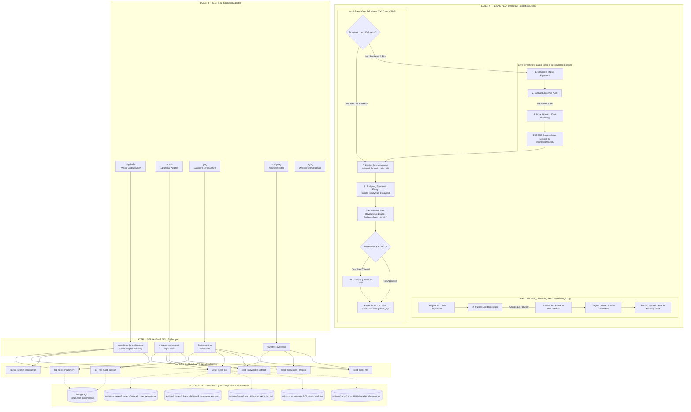

# NPT Fleet: The Master Sail Plan (Workflows & System Architecture)

This document serves as the authoritative single source of truth for all operational execution workflows within the **NPT Fleet Sail Plan**.

---

## 1. The 4-Layer Architectural Hierarchy

In strict alignment with industry best practice and fleet law, the system operates across four uni-directional layers:

```
Layer 4: WORKFLOW (The Sail Plan)
           ↓ dispatches
Layer 3: AGENT    (The Crew / Decision Makers)
           ↓ executes
Layer 2: SKILL    (The Seamanship Recipes / Procedures)
           ↓ invokes
Layer 1: TOOL     (The Rigging & Mechanical Primitives)
```

1. **Layer 1: Tools** (`src/react_agent/tools/`): Pure, deterministic Python functions (database connections, file I/O, scraping, vector math). Zero prompt logic, strict types.
2. **Layer 2: Skills** (`src/react_agent/skills/`): Modular, agent-agnostic operational recipes (e.g. *how* to Popper-audit, *how* to plumb facts, *how* to resolve CrossRef citations). Skills contain zero access-control lists (`agents:` field permanently banned).
3. **Layer 3: Agents** (`src/react_agent/agents/`): Sovereign LLM personas defined exclusively by their XML firmwares (`pegleg.xml`, `cutlass.xml`, etc.). Agents own cognitive lenses, guardrails, and authorized tool/skill repertoires.
4. **Layer 4: Workflows** (`src/react_agent/workflows/`): The **Sail Plan**. Multi-agent state machines and DAGs that own stage sequences, input/output contracts, and gates.

---

## 2. The Core Engine: The Unified Chase Family

The fleet's analytical core is **The Chase**. Rather than competing, disjointed workflows running in conflicting orders, the fleet executes **one invariant analytical sequence across three stop-points**:

$$\mathbf{Bilgeladle\ (Thesis\ Context)} \longrightarrow \mathbf{Cutlass\ (Epistemic\ Audit\ \&\ Locker)} \longrightarrow \mathbf{Grog\ (Fact\ Plumbing)} \longrightarrow \mathbf{Scallywag\ (Satire)} \longrightarrow \mathbf{Peer\ Review}$$

### System Interaction Diagram: The 3 Truncation Levels of the Chase



---

## 3. The Chase Lifecycle Workflows

### Workflow 3.1: `workflow_doldrums_breakout` (Level 1: The Training Loop)
* **Tactical Setting**: **Heaving To**.
* **Objective**: Operational circuit-breaker when an asset is ambiguous, borderline, or blocked by paywalls.
* **Sequence**:
  1. **Bilgeladle**: Performs macro/micro thesis alignment against `ship/SHIP_DECK_PLANS.md` $\rightarrow$ outputs `bilgeladle_alignment.md`.
  2. **Cutlass**: Audits evidentiary claims. If claims are uncalibrated or paywalled, assigns **`DOLDRUMS`**.
  3. **The Heave-To**: Pipeline halts immediately. Pushes diagnostic card to the **Streamlit Triage Console** (`src/react_agent/entrypoints/triage_console.py`).
  4. **Human Calibration**: The Commodore reviews the impasse, provides the authoritative ruling (`MAINSAIL`, `BILGE`, or discard), and writes a permanent learned rule via `record_learned_rule`.

### Workflow 3.2: `workflow_cargo_triage` (Level 2: The Prepopulation Engine)
* **Tactical Setting**: **Cruising Alignment**.
* **Objective**: Evaluate external cargo assets and pre-populate reusable dossiers to eliminate future LLM token spend.
* **Code Implementation**: `src/react_agent/workflows/workflow_cargo_triage.py` (aliased as `cargo_intake_pipeline.py`).
* **Sequence**:
  1. **Turn 1 (Bilgeladle)**: Reads text once, evaluates against 13 Chapter Backbones, locks Primary Chapter Anchor (0–12) and Section Ribs $\rightarrow$ writes `writings/cargo/cargo_{id}/bilgeladle_alignment.md`.
  2. **Turn 2 (Cutlass)**: Reads Bilgeladle's alignment, executes forensic logic audit (SAYS vs IS, Popperian demarcation, Chain of Ruin), assigns authoritative Sail Locker $\rightarrow$ writes `writings/cargo/cargo_{id}/cutlass_audit.md` and commits scorecard to PostgreSQL.
  3. **Turn 3 (Grog)**: Plumbs objective facts, assumptions, and upstream primary sightings $\rightarrow$ writes `writings/cargo/cargo_{id}/grog_extraction.md`.
* **Deliverable**: The reusable **Asset Dossier** in `writings/cargo/cargo_{id}/` is frozen.

### Workflow 3.3: `workflow_full_chase` (Level 3: Full Press of Sail)
* **Tactical Setting**: **All Sail / Full Chase**.
* **Objective**: Complete multi-agent investigative sweep from raw inputs to a publication-ready satirical essay package.
* **Code Implementation**: `src/react_agent/workflows/workflow_full_chase.py`.
* **Sequence**:
  1. **Stage 0 (Pegleg Prompt Inquest)**: Pegleg acts as architectural prompt engineer, deconstructing raw inquiries into a high-signal Forensic Brief (`stage0_forensic_brief.md`), mapping chapter ribs and neutralizing superficial listicle traps.
  2. **Pre-flight Fast-Forward**: Inspects `writings/cargo/cargo_{id}/`. If `bilgeladle_alignment.md`, `cutlass_audit.md`, and `grog_extraction.md` already exist from Level 2, **skips Turns 1–3 with zero token spend**. If absent, executes Level 2.
  3. **Turn 4 (Scallywag Synthesis Essay)**: Consumes the Stage 0 Forensic Brief, Bilgeladle's thesis anchors, Cutlass's forensic targets, Grog's extracted facts, and singular primary chapter text to author an unvarnished synthesis essay with strict Toulmin warrants $\rightarrow$ writes `writings/chases/{chase_id}/stage5_scallywag_essay.md`.
  4. **Turn 5 (Adversarial Peer Reviews - 3 Specialists)**: Bilgeladle (thesis & chapter fidelity), Cutlass (epistemic rigor & anti-slop), and Grog (cargo asset meaning preservation: *"Does Scallywag accurately represent the cargo asset's meaning?"*) independently audit the essay on the universal **0.0 to 10.0 Epistemic Signal Scale** $\rightarrow$ writes `stage6_bilgeladle_review.md`, `stage6_cutlass_review.md`, `stage6_grog_review.md`, and `stage6_peer_reviews.md`.
  5. **Stage 5B (Scallywag Revision Gate)**: If ANY reviewer scores $< 8.0 / 10.0$ or flags listicle superficiality, Pegleg dispatches an adversarial revision turn to rewrite `stage5_scallywag_essay.md`.
  6. **Status Logging**: Pegleg commits completion status and scorecard to `writings/chases/{chase_id}/chase_status.md` and `cargo.fleet_enrichments`.

---

## 4. Operational & Fleet Infrastructure Workflows

### Workflow 4.1: `workflow_cargo_intake` (Web Content Seizure)
* **Tactical Setting**: **Plain Sail**.
* **Objective**: Safely ingest external URLs, academic PDFs, or arXiv documents into Google Cloud Storage without token bloat.
* **Lead Agent**: `spyglass`.
* **Sequence**:
  1. `check_cargo_manifest(url)`: Pre-flight dedup check. If already ingested, returns existing GCS pointer.
  2. Tier 1 Acquisition: `download_url` / `download_remote_pdf` via requests + Trafilatura.
  3. Tier 2 Fallback: Botasaurus headless scraper for anti-bot / JavaScript paywalls.
  4. Metadata Extraction: Extracts Dublin Core, Highwire Press, and JSON-LD metadata.
  5. Cloud Upload: `upsert_knowledge_artifact` streams payload to `gs://npt-fleet-cargo-hold/acquisitions/[slug].txt`.
  6. Database Registration: Commits record to `cargo.content_metadata` and dequeues from `cargo.ingestion_queue`.

### Workflow 4.2: `workflow_manuscript_bronze_plus` (Manuscript Slicing & Assembly)
* **Tactical Setting**: **Yardarm Refitting**.
* **Objective**: Slices raw chapter monoliths and assembles section-level Bronze+ files with 100% verified, live-URL citation nodes.
* **Manning Crew**: `bilgeladle` $\rightarrow$ `plank` $\rightarrow$ `bilgeladle` $\rightarrow$ `cutlass` $\rightarrow$ `pegleg`.
* **Sequence**:
  1. **Stage 1 (Bilgeladle)**: Slices sacred manuscript monolith into section files (`chXX_secX.Y_bronze.md`) and raw references.
  2. **Stage 2 (Plank)**: Queries CrossRef API, validates URLs via Landlubber, and formats exhaustive citation nodes (`chXX_references.md`).
  3. **Stage 3 (Bilgeladle)**: Injects verified vector nodes into body prose (preserving 100% of author text verbatim) $\rightarrow$ writes `ship/bronze_plus/chapters/chXX/chXX_secX.Y_bronze_plus.md`.
  4. **Stage 4 (Cutlass)**: Evidentiary audit comparing assertions against seized evidence $\rightarrow$ `chXX_citation_audit.md`.
  5. **Stage 5 (Pegleg)**: Enforces Completeness Gate (`BILGELADLE-RULE-022`) requiring 100% live URLs before approving the chapter.

### Workflow 4.3: `workflow_vector_embedding` (Deep Soundings - VDB Indexing)
* **Tactical Setting**: **Deep Soundings**.
* **Objective**: Slices text into paragraph chunks, generates Gemini embeddings, and commits vectors to PostgreSQL `pgvector`.
* **Engines**: `src/react_agent/tools/manuscript_etl.py` and `cargo_vector_tools.py`.
* **Sinks**:
  - Manuscript chunks: `ship.letters_of_marque` (768-dim embeddings).
  - Cargo hold assets: `cargo.content_vectors` (1536-dim embeddings).

### Workflow 4.4: `workflow_autonomous_meta_learning` (Rules Audit & Promotion)
* **Tactical Setting**: **Muster Roll**.
* **Objective**: Surveys local agent memory vaults, prunes dead heuristics, and promotes universal principles to shared fleet storage.
* **Manning Crew**: `pegleg` & `hook`.
* **Tools**: `conduct_learned_rules_audit`.

### Workflow 4.5: `workflow_dispatch_task` (Light Working Sail - Agile Delegation)
* **Tactical Setting**: **Light Working Sail**.
* **Objective**: Single-agent delegation for targeted questions, lookups, or single-file edits without multi-stage pipeline overhead.
* **Manning Crew**: `pegleg` $\rightarrow$ Selected Specialist Agent (`dispatch_subagent_turn`).

---

## 5. Master Sail Plan Registry Summary

| Workflow ID | Setting | Manning Crew | Primary Input | Primary Output |
| :--- | :--- | :--- | :--- | :--- |
| **`workflow_doldrums_breakout`** | Heaving To | `bilgeladle`, `cutlass`, Commodore | Uncalibrated Cargo | Triage UI Decision & Learned Rule |
| **`workflow_cargo_triage`** | Cruising Alignment | `bilgeladle` $\rightarrow$ `cutlass` $\rightarrow$ `grog` | Raw Ingested Cargo | Dossier in `writings/cargo/cargo_{id}/` |
| **`workflow_full_chase`** | All Sail | `pegleg` $\rightarrow$ Crew | Cargo ID(s) + Inquiry Prompt | Publication in `writings/chases/{chase_id}/` |
| **`workflow_cargo_intake`** | Plain Sail | `spyglass` | Target URL / PDF / arXiv | GCS `.txt` & `cargo.content_metadata` |
| **`workflow_manuscript_bronze_plus`** | Yardarm Refitting | `bilgeladle`, `plank`, `cutlass`, `pegleg` | Monolith Chapter | Clean Section Files in `ship/bronze_plus/` |
| **`workflow_vector_embedding`** | Deep Soundings | `manuscript_etl`, `cargo_vector_tools` | Bronze+ Sections / Cargo | Vectors in `letters_of_marque` |
| **`workflow_autonomous_meta_learning`** | Muster Roll | `pegleg`, `hook` | Agent Memory Vaults | Promoted Rules in `shared_fleet_rules.json` |
| **`workflow_dispatch_task`** | Light Working Sail | `pegleg` $\rightarrow$ Specialist | Ad-Hoc Inquiry | Consolidated Specialist Answer |
