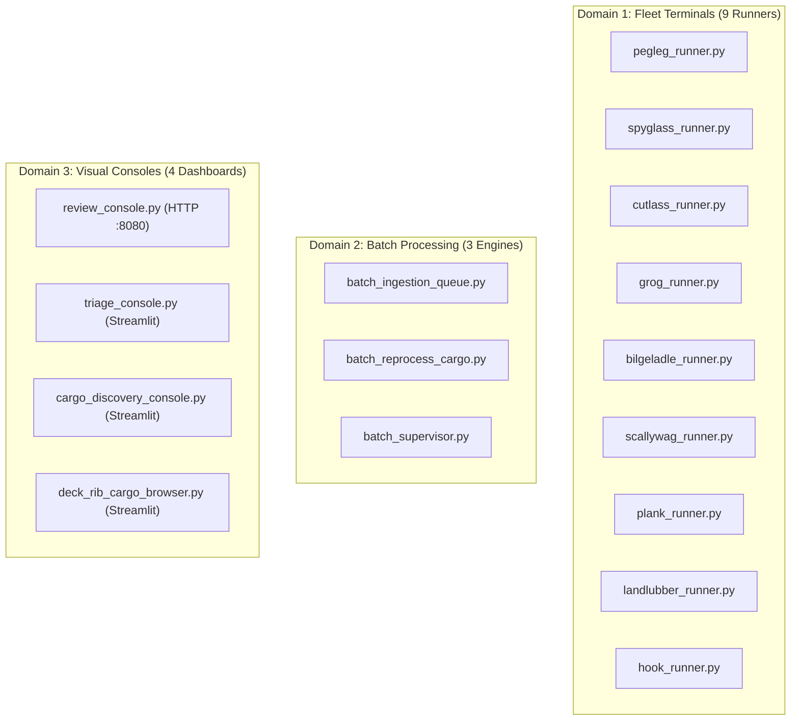

# NPT Fleet: Execution Layer (`entrypoints/`)

This directory is the **Execution Layer** of the NPT Fleet. Following **SOP-06 (The "Pure Engine" Execution Pattern)** and **ADR-021 (The Two-Executable-Directories Law)**, the core `AgentEngine` is kept completely free of `while True:` loops, CLI parsing, or terminal logic. Instead, these entrypoints serve as the runtime wrappers that instantiate the engine, parse command-line arguments, manage conversational threads, and execute batch pipelines or visual web dashboards.

---

## 🏛️ Directory Architecture: 17 Canonical Entrypoints

---

## Domain 1: Canonical Fleet Terminals (9 Agents)
Every fleet agent has an official CLI runner connecting human interaction to `AgentEngine` with PostgreSQL checkpoint persistence:

1. **`pegleg_runner.py`** — **Mission Commander & Agile DAG Foreman**
   - *Command:* `uv run python src/react_agent/entrypoints/pegleg_runner.py`
   - *Role:* Interactive terminal with `[AUTHOR] ->` prompt. Handles single-turn chase dispatch via `--prompt` and compiles learned rules to RDF/Turtle via `--compile-ontology`.

2. **`spyglass_runner.py`** — **Content Seizure & Ingestion Engine**
   - *Command:* `uv run python src/react_agent/entrypoints/spyglass_runner.py [--url <URL>]`
   - *Role:* Implements ADR-005 (Dual-Mode). In headless mode (`--url`), executes atomic acquisition (`check -> download -> upsert -> log`); interactive if run bare.

3. **`cutlass_runner.py`** — **Epistemic Auditor & Triage Officer**
   - *Command:* `uv run python src/react_agent/entrypoints/cutlass_runner.py`
   - *Role:* Forensic audit terminal. Evaluates external cargo against the 32 epistemic failure modes and establishes triage verdicts (`MAINSAIL`, `BILGE`, `DOLDRUMS`).

4. **`grog_runner.py`** — **Quartermaster & Core Content Specialist**
   - *Command:* `uv run python src/react_agent/entrypoints/grog_runner.py`
   - *Role:* Atomic fact and structural extraction terminal. Generates prompt-free reusable asset dossiers in `writings/cargo/cargo_{id}/grog_extraction.md`.

5. **`bilgeladle_runner.py`** — **Thesis Alignment Engine & Archivist**
   - *Command:* `uv run python src/react_agent/entrypoints/bilgeladle_runner.py`
   - *Role:* Aligns external cargo against the 13 Chapter Backbones of *The End of Knowing* (`SHIP_DECK_PLANS.md`). Automatically pre-flights and injects live definitions from `cargo.system_glossary`.

6. **`scallywag_runner.py`** — **Diagnostician of Misanthropes & Malintent**
   - *Command:* `uv run python src/react_agent/entrypoints/scallywag_runner.py`
   - *Role:* Narrative drafting terminal. Converts thesis-aligned dossiers into satirical essays and misanthrope diagnoses.

7. **`plank_runner.py`** — **Bibliographer & Reference Resolver**
   - *Command:* `uv run python src/react_agent/entrypoints/plank_runner.py`
   - *Role:* CrossRef API resolver and citation validator. Expands and normalizes reference vector nodes into Bronze+ manuscript chapters.

8. **`landlubber_runner.py`** — **Web & Search Grounding Helper**
   - *Command:* `uv run python src/react_agent/entrypoints/landlubber_runner.py "<query>"`
   - *Role:* Stateless single-shot runner invoked via subprocess by `call_landlubber` / `search_web`. Queries Google Search via Vertex AI and terminates immediately.

9. **`hook_runner.py`** — **Meta-Architect & Schema Progenitor**
   - *Command:* `uv run python src/react_agent/entrypoints/hook_runner.py`
   - *Role:* Lead architect terminal. Instantiates Hook under pure `AgentEngine` with persistent developer audit logging to `logs/hook_requests.log`.

---

## Domain 2: Headless Batch Engines & Supervisors (3 Files)
Orchestration wrappers designed for high-throughput unattended batch processing:

10. **`batch_ingestion_queue.py`** — **Concurrency-Safe Ingestion Worker**
    - *Command:* `uv run python src/react_agent/entrypoints/batch_ingestion_queue.py`
    - *Mechanics:* Uses PostgreSQL `SELECT ... FOR UPDATE SKIP LOCKED` on `cargo.ingestion_queue` for lock-free parallel execution. Spawns isolated LangGraph thread IDs (`batch_worker_{uuid}`) per item to eliminate context runaway.

11. **`batch_reprocess_cargo.py`** — **Level 2 Shared-Thread Reprocessor**
    - *Command:* `uv run python src/react_agent/entrypoints/batch_reprocess_cargo.py --locker BILGE`
    - *Mechanics:* Executes the unified 3-turn inverted pipeline (`Bilgeladle -> Cutlass -> Grog`). Supports `--ids`, `--locker`, spending caps, pre-flight dossier skips, and automated retry circuit breakers.

12. **`batch_supervisor.py`** — **Process-Isolated Micro-Batch Supervisor**
    - *Command:* `uv run python src/react_agent/entrypoints/batch_supervisor.py`
    - *Mechanics:* Runs batch ingestion in safe micro-batches (default: 25 items), refreshing memory, sockets, and DB connections between batches, while displaying real-time ETA telemetry.

---

## Domain 3: Interactive Visual Consoles & Dashboards (5 Files)
Full-featured human-in-the-loop web dashboards:

13. **`review_console.py`** — **Zero-Dependency Review Server**
    - *Command:* `uv run python src/react_agent/entrypoints/review_console.py`
    - *Port:* `http://localhost:8080`
    - *Role:* Pure Python HTTP server (`HTTPServer`) to inspect acquired cargo, GCS plain text, metadata rows, and generated dossiers with zero external UI dependencies.

14. **`triage_console.py`** — **Cutlass Rapid Triage & Calibration Console**
    - *Command:* `uv run streamlit run src/react_agent/entrypoints/triage_console.py`
    - *Role:* Streamlit dashboard for zero-token asset inspection, fast-triage validation, and human-in-the-loop sail locker calibration.

15. **`cargo_discovery_console.py`** — **Cargo Discovery & Organic Clustering**
    - *Command:* `uv run streamlit run src/react_agent/entrypoints/cargo_discovery_console.py`
    - *Role:* Streamlit + Plotly 2D Topic Galaxy and Treemap for unsupervised mathematical cargo clustering ($0.00 token cost).

16. **`deck_rib_cargo_browser.py`** — **Deck Rib & Cargo Cluster Browser**
    - *Command:* `uv run streamlit run src/react_agent/entrypoints/deck_rib_cargo_browser.py --server.port 8504`
    - *Role:* Two-way coordinated navigation map linking 140 Section Ribs from `SHIP_DECK_PLANS.md`, Bronze+ verbatim text, and 100 cargo clusters in an interactive M:N mesh.

---

## 🚫 Architectural Governance: Zero-Scratch Law
Per **ADR-021** and **SOP-10**:
- **No Scratch Files:** One-off exploratory or temporary testing scripts must NEVER be saved in `entrypoints/`. Use `scratch/`.
- **Pure Functions Only in Libraries:** Never add runnable scripts to `src/react_agent/core/` or `src/react_agent/tools/`.
- **Execution Law:** Every entrypoint must strictly be executed via `uv run python ...` or `uv run streamlit run ...`.
